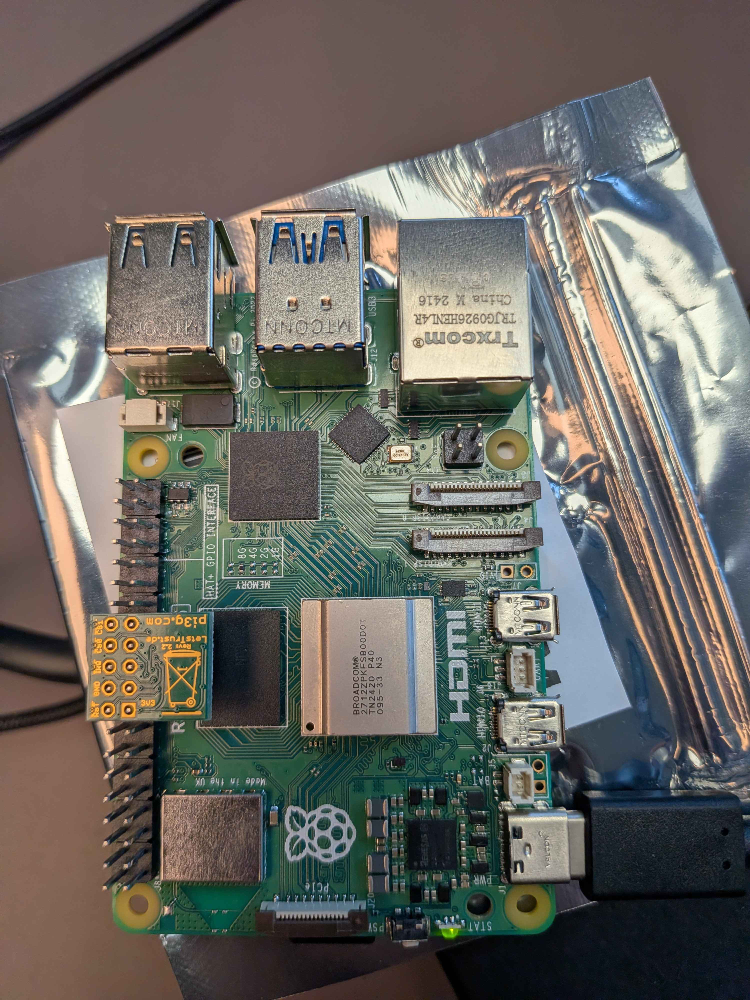

# Assignment 2

## System Setup

TPM-A is hosted on our Raspberry PI.
TPM-B is hosted on one of our laptops.

**Connecting the tpm using the pinout:**
Looking at the diagram found at https://pinout.xyz/pinout/letstrust_tpmt we orientate the Pi with the GPIO on the right and the HDMI ports on the left. On the TPM we can see the the 3v3 power, we use place that on pin 17 on the pi, thereby aligning all the pins and installing the tpm according to the pinout diagram. 



Afterwards we manually enable the driver inside the config.txt located in
/boot/firmware/config.txt and below the [all] section we add:
```
dtoverlay=tpm-slb9670
```

### tpm2_createprimary
`tpm2_createprimary -C e` is used to create a primary key. It is the parent and has the attributes `TPMA_OBJECT_RESTRICTED|TPMA_OBJECT_DECRYPT|TPMA_OBJECT_FIXEDTPM|TPMA_OBJECT_FIXEDPARENT|TPMA_OBJECT_SENSITIVEDATAORIGIN|TPMA_OBJECT_USERWITHAUTH`, these are the default attributes. `fixedtpm` means the key can only exist in this TPM, and `sensitivedataorigin` means the TPM generated the private part itself.

### tpm2_create
`tpm2_create -C primary.ctx` creates the signing key as a child. It has the attributes `TPMA_OBJECT_SIGN_ENCRYPT|TPMA_OBJECT_DECRYPT|TPMA_OBJECT_FIXEDTPM|TPMA_OBJECT_FIXEDPARENT|TPMA_OBJECT_SENSITIVEDATAORIGIN|TPMA_OBJECT_USERWITHAUTH`, this is also the defaults. 

### Attributes
- RESTRICTED: The key is limited to the TPM’s own internal operations, like wrapping child keys, and cannot be used on random data.
- FIXEDTPM: The key cannot be duplicated or moved to another TPM.
- FIXEDPARENT: The key cannot be re-parented, so its bound to the primary key.
- SENSITIVEDATAORIGIN: the TPM generated the private part itself, so it was never known outside the TPM.
- USERWITHAUTH: The key can be used with authorization (an empty password here).
- SIGN_ENCRYPT: The key can be used to sign. 
- DECRYPT: The key be used to decrypt.

Compared with the child key, the differences are: the primary has RESTRICTED and no SIGN, while the child has SIGN and no RESTRICTED. That means tpm2_sign works on the child but not on the primary.


**tpm2_load**
`tpm2_load` loads the child into the TPM and produces a context file used for signing.

The saved `.priv` file is the private key wrapped under the parent key. It is unusable on any other TPM and in ordinary software.


## TPM-A and TPM-B Architecture
### TPM A (Rasberry PI)
Has TPM 2.0 chip  
primary key and signing key (RSA/ECC)
tpm2-tools
tpm2_sign(message)
tpm2_readpublic: creates public key 
private key never leaves TPM 


### TPM-B (PC)
tpm2-tools
message.dat
signature
public key (PEM)
tpm2_loadexternal: Creates a context file from the public key used by tpm2_verifysignature 
tpm2_verifysignature: Used for verifying message


The two devices are independent. The only things that are sent from TPM-A to TPM-B are the message, the signature, and the public key.

## RSA Signing and Verification Workflow
Signing:
Firstly the parent object is created. Then the child object/ RSA key pair is created - Both are created with RSA encryption.

Next step is to load primary context, rsa public and private keys and export them into rsa.ctx file. The message file is then created.

Then the message is signed using the loaded TPM context.
________ 
Verification:
Firstly the files created at TPM-A are pulled to TPM-B, these are message.dat, sig.rssa, public.pem; So the message, the signature and the public key. 

The original message is the verified by checking the integrity through the public key, signature and message.


## ECC Signing and Verification Workflow
Signing:
Firstly the parent object is created. Then the child object/ ECC key pair is created - Both are created with ECC encryption.

Next step is to load primary context, rsa public and private keys and export them into rsa.ctx file. The message file is then created.

Then the message is signed using the loaded TPM context.
________ 
Verification:
Firstly the files created at TPM-A are pulled to TPM-B, these are message.dat, sig.rssa, public.pem; So the message, the signature and the public key. 

The original message is the verified by checking the integrity through the public key, signature and message.

## PCR-bound key mechanism

## Tampered Key Rejection
Evidence that the tampered key is rejected can be found in the evidence folder /evidence/task2_RSA/tpm_b.png.
We added to the script that TPM-B should also attempt to verify a tampered message, this message can be found in /scripts/task2_RSA/message_tampered.dat. 

The same goes for the ECC implemantation, it is exactly the same setup.


## What Can TPM-B Not Conclude?

## Limitation of Experiment
